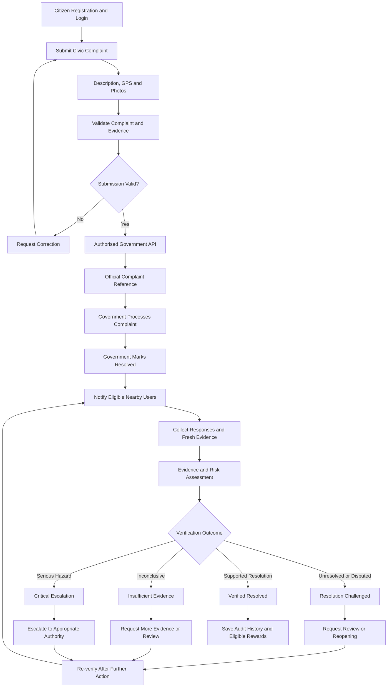

# ResolveProof
### Verify the Reality. Not Just the Status.

**ResolveProof** is a civic-tech platform designed to help citizens report local problems, connect complaints with government grievance systems, and independently verify whether reported issues have actually been resolved.

The goal is to make public grievance redressal more transparent, accountable, and evidence-based by combining citizen participation, location-based verification, AI-assisted evidence analysis, and an auditable complaint history.

## The Problem

Citizens report problems such as damaged roads, overflowing garbage, broken streetlights, water leakage, and drainage issues. However, several challenges remain:

- Citizens may struggle to track the progress of their complaints.
- A complaint may be marked as resolved even when the problem remains on the ground.
- There may be insufficient independent evidence to confirm the actual outcome.
- Repeated complaints about the same issue can make tracking and accountability difficult.
- Citizens often lack a simple way to contribute to independent verification.

## Our Solution

ResolveProof aims to connect citizen complaints with the official government grievance process and add a separate verification layer.

Citizens submit complaints through the ResolveProof app, including a description, GPS location, and supporting photographs or videos. Through an authorised government API, the complaint can be forwarded to the appropriate grievance system.

When the government marks a complaint as resolved, ResolveProof invites eligible users near the reported location to help verify the outcome. Their responses and supporting evidence are assessed to determine whether the resolution is sufficiently supported, disputed, or still uncertain.

**ResolveProof does not replace the government grievance system. It adds an independent layer of verification and accountability.**

## Key Features

### 1. Citizen Registration and Login
- Mobile number-based registration and OTP verification.
- Secure user accounts and complaint history.
- Additional identity verification only where legally necessary and appropriately authorised.

### 2. Complaint Registration
- Submit complaints about local civic issues.
- Enter the complaint description and category.
- Capture GPS coordinates and the reported location.
- Attach photographs or videos as supporting evidence.
- Track the complaint and its verification history.

### 3. Government Grievance Integration
- Planned integration with Punjab's Public Grievance Redressal System (PGRS) through the Connect Punjab platform.
- Forward complaint details through an authorised API, if access is granted.
- Store the official complaint reference number and submission status.
- Retrieve government status updates where supported by the integration.
- Support evidence-backed requests for review or reopening where the official system permits.

**Important:** Public third-party API access has not yet been verified. Live government integration depends on official authorisation, API documentation, and any required sandbox access. Until then, the hackathon prototype can use a clearly labelled simulated government system.

### 4. Location-Based Community Verification
- When a complaint is marked resolved, identify eligible users near its reported location.
- Send push notifications to users who have granted the required location and notification permissions.
- Use a configurable nearby radius, initially proposed at approximately 50–100 metres.
- Let users respond:
  - **YES:** The issue appears to be resolved.
  - **NO:** The issue appears to remain.
  - **CAN'T TELL:** There is insufficient information to decide.
- Allow users to submit fresh photographs or other supporting evidence.

Location proximity helps identify potential verifiers; it does not prove that a person witnessed the issue or that their response is accurate.

### 5. AI-Assisted Evidence Analysis
- Check whether submitted evidence appears relevant to the complaint.
- Identify possible duplicate or reused photographs.
- Assess available timestamps and location consistency.
- Flag suspicious patterns, contradictory responses, and uncertain cases.
- Summarise the available evidence and help prepare review reports.

AI may assist with image analysis, text summarisation, and report preparation. It cannot guarantee that a photograph is genuine or independently establish that a problem has been fixed. Important or disputed cases may require human review.

### 6. Independent Verification Outcomes

ResolveProof aims to classify complaints into four outcomes:

- **VERIFIED RESOLVED:** Sufficient evidence supports that the issue has been fixed.
- **RESOLUTION CHALLENGED:** Credible evidence suggests the issue remains or the reported resolution requires investigation.
- **INSUFFICIENT EVIDENCE:** The available evidence is incomplete, inconclusive, or contradictory.
- **CRITICAL ESCALATION:** A serious unresolved hazard requires urgent attention from the appropriate authority.

These are ResolveProof verification outcomes, not replacements for the government's official complaint status.

### 7. Evidence-Based Escalation
- Prepare a summary of unresolved issues and supporting evidence.
- Notify the complainant about the verification result.
- Generate a request for departmental review or reopening where supported.
- Route serious cases to the appropriate authority, such as the relevant department or SDM where applicable.
- Re-verify the issue after further government action.

An escalation is considered submitted to an authority only when the relevant authorised channel confirms submission.

### 8. Civic Points and Rewards
- Recognise useful, accepted verification contributions through Civic Points.
- Apply eligibility checks and anti-fraud rules before awarding points.
- Maintain a transparent record of reward decisions.
- Explore UPI-based cash rewards in a future phase, subject to funding, payment-provider requirements, applicable laws, and fraud prevention.

Points are intended to reward useful evidence—not simply a YES or NO vote, the number of submissions, or agreement with a particular outcome. Cash conversion is a proposed future feature, not a currently guaranteed payment.

### 9. Transparency and Audit History
- Maintain complaint status and verification history.
- Record evidence submissions, timestamps, review outcomes, and escalation attempts.
- Keep government status separate from ResolveProof's verification result.
- Provide clear explanations when evidence is insufficient or a decision requires review.

## Final Project Workflow

The complete planned workflow is:

1. **Register or log in:** A citizen creates an account using a mobile number and OTP.
2. **Create a complaint:** The citizen enters the problem description, category, GPS location, and supporting photos or videos.
3. **Validate the submission:** ResolveProof checks required fields, file safety, location information, and possible duplicate complaints.
4. **Submit to the government:** The backend forwards the complaint through an authorised Punjab government API. If live access is unavailable, the prototype uses a simulated government system.
5. **Receive the reference:** Store the official complaint ID and submission confirmation when provided by the government system.
6. **Government action:** The relevant department processes the complaint and updates its official status.
7. **Resolution trigger:** When the government marks the issue resolved, ResolveProof starts independent verification.
8. **Notify nearby users:** Eligible users within the configured radius receive a verification request, subject to their permissions and notification settings.
9. **Collect evidence:** Users respond YES, NO, or CAN'T TELL and may provide fresh photographs or other relevant evidence.
10. **Evaluate the evidence:** ResolveProof checks consistency, freshness, possible duplicates, location information, community responses, and uncertainty. Suspicious or disputed cases can be sent for human review.
11. **Assign a verification outcome:** The system records VERIFIED RESOLVED, RESOLUTION CHALLENGED, INSUFFICIENT EVIDENCE, or CRITICAL ESCALATION.
12. **Escalate when necessary:** Prepare an evidence-backed review or escalation through an authorised channel when the issue remains unresolved or presents a serious hazard.
13. **Re-verify:** After further action, repeat the verification process and update the history.
14. **Award eligible Civic Points:** Recognise genuine, useful contributions according to the project's reward rules.

## Workflow Diagram

## Proposed Technology Stack

The following stack is proposed for development; the final implementation may evolve.

**Frontend**
- React or Next.js for the web interface.
- A mobile-friendly interface for complaint submission and verification.
- GPS, camera/file uploads, and push notifications through supported device capabilities.

**Backend**
- Python with FastAPI for application APIs and workflow management.
- Secure authentication and role-based access.
- Government integration through an authorised API adapter.

**Database**
- PostgreSQL for users, complaints, evidence metadata, status history, verification outcomes, and reward records.
- Secure object storage for uploaded photographs and videos.

**AI and Evidence Processing**
- Gemma 4 through an appropriate supported API for text summarisation and report drafting.
- Computer vision and image-similarity techniques for evidence relevance and potential duplicate detection.
- Rule-based verification and risk assessment, with human review for uncertain or high-risk cases.

**Notifications**
- Push notifications for eligible nearby verifiers.
- Appropriate location permissions and configurable proximity checks.

**Rewards**
- Civic Points ledger with eligibility and anti-fraud checks.
- Possible future UPI integration through an authorised payment provider.

## System Architecture

ResolveProof is planned around these main components:

1. **Citizen application:** Registration, complaint submission, status tracking, and verification responses.
2. **Application backend:** Authentication, permissions, complaint processing, and workflow orchestration.
3. **Government integration adapter:** Sends and retrieves information through authorised government interfaces.
4. **Evidence service:** Handles uploads, metadata, duplicate checks, and evidence assessment.
5. **Verification engine:** Applies defined rules to evidence and community feedback.
6. **Notification service:** Identifies eligible nearby users and sends verification requests.
7. **Reviewer dashboard:** Supports investigation of disputed, suspicious, or urgent cases.
8. **Rewards and audit service:** Records eligible contributions, points, decisions, and relevant events.

Government API credentials and other secrets must remain on the backend, not in the mobile or browser application.

## Privacy, Security, and Responsible Use

ResolveProof is designed to follow privacy-conscious and security-first principles:

- Request location and camera permissions only when needed.
- Explain why complaint data and verification evidence are collected.
- Protect personal information and restrict access according to user roles.
- Do not expose complainants' phone numbers or Aadhaar numbers to nearby verifiers.
- Do not collect or store Aadhaar numbers by default; use an authorised verification method only if necessary and legally permitted.
- Encrypt sensitive information in transit and apply appropriate protection at rest.
- Keep API keys, credentials, and secrets out of source control.
- Apply rate limits, upload validation, duplicate detection, and anti-fraud controls.
- Retain evidence only as long as justified by the project's stated purpose and applicable requirements.
- Provide a review process for disputed outcomes and suspected false reports.
- Avoid publishing sensitive location information or identifiable photographs unnecessarily.

## Expected Impact

ResolveProof aims to:

- Improve transparency in civic grievance resolution.
- Help identify complaints that may have been marked resolved prematurely.
- Encourage responsible citizen participation.
- Create an evidence-backed history of complaint outcomes.
- Help authorities identify recurring problems and prioritise follow-up.
- Build trust through independent verification rather than relying solely on a status label.

These are intended outcomes; actual impact will need to be evaluated through testing and real-world deployment.

## Current Development Status

ResolveProof is a project in development.

- **Project concept and workflow:** Defined.
- **GitHub repository and project documentation:** Available.
- **Citizen app and backend:** To be implemented and tested.
- **Live Punjab government integration:** Pending authorised API access.
- **Community notifications and verification:** Planned.
- **AI-assisted evidence analysis:** Planned; requires testing and evaluation.
- **Civic Points:** Planned; cash rewards require additional funding and compliance work.
- **Production deployment:** Not yet established.

For hackathon demonstrations, simulated government responses and sample complaints should be clearly labelled as demo data. No live government submission should be claimed unless it has been implemented and verified.

## Future Scope

- Complete mobile application and secure backend.
- Obtain authorised PGRS integration documentation and sandbox access.
- Implement complaint tracking and government status synchronisation.
- Develop proximity-based notifications and evidence collection.
- Evaluate image similarity and evidence consistency techniques.
- Build a reviewer dashboard for disputed and urgent cases.
- Introduce an auditable Civic Points system.
- Explore authorised reward payments and broader government integrations.
- Measure verification accuracy, false reports, response rates, and time to resolution.

## Project Repository

GitHub: https://github.com/aryandhamanii/ResolveProof

## Conclusion

ResolveProof aims to bridge the gap between a complaint being marked resolved and the problem actually being fixed. By combining official grievance workflows with independent evidence collection, community verification, and transparent escalation, the project seeks to make civic problem-solving more accountable and trustworthy.

**ResolveProof — Verify the Reality. Not Just the Status.**
